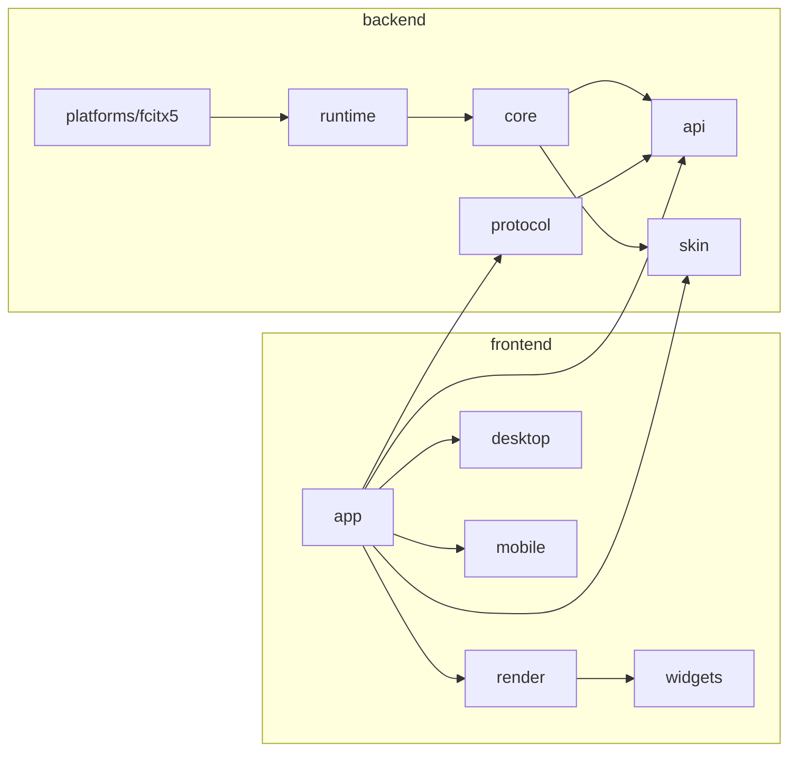
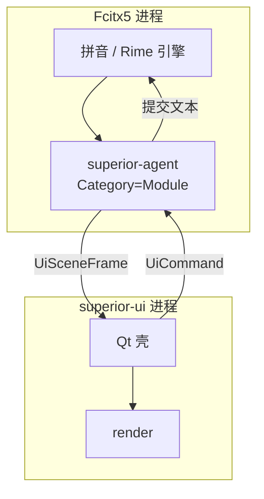

# 架构

> 本文档描述运行拓扑与模块划分。**分层判据以仓库外的
> [`架构设计.md`](../../架构设计.md) 为准**：状态、决策、能力、效果四个盒子，
> 以及 P-1~P-5 五条第一原则。两者冲突时修正本文档。

Superior-IME 的第一原则：**前端与后端分开，UI 只能通过契约与后端通信。**

参考 `fl-scx` 的排布（`lib/backend` 纯后端、`lib/pages` + `lib/widgets` 纯前端），C++ 侧对应为 `backend/` 与 `frontend/`。

---

## 1. 目录与职责

```
backend/                 纯后端：无 Qt、无窗口、headless 可测
├─ api/                  契约：事件、场景帧、命令、端口、能力
├─ core/                 决策层：模式、按键归属、候选、场景折叠、语音状态
├─ pinyin/               能力：拼音（librime + 万象）
├─ runtime/              串行泵、票据、代次隔离、确定性采样
├─ skin/                 皮肤模型、校验、内容哈希
├─ protocol/             IPC 帧编解码与能力协商
└─ platforms/
   ├─ fcitx5/            Fcitx5 agent addon、classicui 主题导出
   ├─ windows/           预留
   └─ android/           预留

frontend/                纯前端：只依赖 api / protocol / skin
├─ app/                  应用装配与 main()
├─ render/               皮肤驱动布局、九宫格、字体度量、命中区
├─ desktop/              桌面壳：候选窗、状态栏、托盘
├─ mobile/               移动壳（预留）
└─ widgets/              共享绘制控件

tools/                   开发工具
skins/                   内置皮肤
tests/                   单元、golden、边界
```

依赖方向：



硬规则：

1. `frontend/` 不得 include 或链接 `superior/core`、任何 `fcitx*`。
2. `backend/core` 不得 include Qt / Fcitx5 / 平台头，也不读墙钟。
3. `backend/skin` 是纯数据层：不依赖 Qt，不做像素解码。
4. `backend/api` 无实现依赖。
5. 前后端只通过 `superior::api` 类型与 `superior::proto` 帧通信。

这些规则由 `scripts/check-boundaries.sh` 机械化检查，并作为 ctest 用例执行。它不是"注释里的约定"。

---

## 2. 运行时拓扑



- **文本输入由内置 librime 完成**（`backend/pinyin` + `libsuperiorpinyin.so`）。
  Superior-IME 不自己实现拼音语言模型，只做引擎适配，见
  [docs/pinyin-engine.md](pinyin-engine.md)。
- **语义状态在 agent**：候选、选中、可见性、皮肤代次、语音状态。
- **瞬时视觉状态在 UI**：hover、按下、动画进度。
- UI 崩溃不影响输入；agent 继续提交文本，UI 重连后重建快照。

---

## 3. 为什么 agent 不是 UI addon

Fcitx5 的 `UserInterfaceManager` 同一时刻只持有一个 `ui_` 指针。如果 Superior 抢占 UI addon：

- 必须同时实现 `InputPanel` 与 `StatusArea`；
- classicui 不能共存；
- Wayland 下候选窗仍受 `getInputPopupSurface` 私有接口限制。

因此 P0 的 agent 使用 `Category=Module`，只观察 `InputContextUpdateUIEvent`，把状态转发给独立 UI 进程；classicui 继续负责 Wayland 候选窗，Superior UI 负责 X11 候选窗与右下角状态栏。P1 再评估 Wayland 输入弹窗表面。

---

## 4. 场景帧与命令

### 4.1 下行：`UiSceneFrame`

完整期望场景，不是增量：

```cpp
struct UiSceneFrame {
  FrameId frameId;
  SessionKey session;
  PanelScene panel;       // 可见性、锚点、皮肤、预编辑、候选、命中区
  StatusScene status;     // 状态栏项
  std::optional<TransitionSpec> transition;
};
```

- 丢帧安全：下一帧仍是完整真相。
- 动画只传 `TransitionSpec`，UI 本地采样，不跑高频 IPC。
- 帧带 `skinGeneration`；UI 丢弃与当前代次不符的帧。

### 4.2 上行：`UiCommand`

只允许语义命令：

```cpp
ActivateCandidate { session, candidateId }
PageCandidates    { session, delta }
SetInputMode      { session, mode }
SetSkin           { skinId }
ToggleStatusItem  { itemId }
VoiceStart/Stop/Cancel { session }
MovePanel         { session, deltaX, deltaY }
```

不存在 `SetPanelRect { x, y }`。窗口位置由平台后端根据光标锚点与用户偏移决定。

点击用 `candidateId` 而不是 index，避免异步竞态。

已接通的命令（agent 侧 `applyCommand`）：

| 命令 | 行为 |
|---|---|
| `ToggleStatusItem { itemId }` | 只认 `inline-mode`：切换内联中英文；其他 id 记日志后忽略 |
| `SetInputMode { mode }` | 直接设定内联中英文 |
| `SetUiScale { scale }` | UI 自己应用（它就是设置文件的读者），agent 只记日志 |

未接通的命令一律**忽略并记日志**，不是报错：旧 UI 连新 agent 时不能把状态搞坏。
命令不携带几何信息，也不携带引擎内部状态，这是这一层唯一的硬约束。

---

## 5. 平台后端

| 后端 | 候选窗 | 状态栏 | 备注 |
|---|---|---|---|
| X11 / XWayland | Qt override-redirect，跟随 `cursorRect` | 同左，四角可选 | M3 ✅ |
| Wayland | 自绘输入窗（`setCustomInputPanelCallback`）；其他输入法仍用 classicui | `wlr-layer-shell` 锚定 | 见 [input-panel.md](input-panel.md) |
| Windows | TSF + UI broker | 独立窗口 | 预留 |
| Android | `InputMethodService` 原生 | 原生 | 预留 |

`frontend/` 不感知这些差异；差异封装在 `backend/platforms/*` 与 `frontend/desktop` 的窗口宿主中。

---

## 6. 当前实现状态

| 模块 | 状态 |
|---|---|
| `backend/api` | 契约头文件已就绪 |
| `backend/diagnostics` | 已实现：统一日志、级别/类别过滤、Qt 桥 |
| `backend/skin` | 已实现：加载、校验、token、资源、哈希 |
| `tools/skin-lint` | 已实现 |
| `skins/default` | 已提供 |
| `backend/core` | 已实现：`Modes`（模式唯一 owner）、`KeyPolicy`（按键归属）、`CandidateModel`（代次稳定 id）、`SceneInput`（引擎/宿主事实折叠）、`ImeSession` |
| `backend/protocol` | 已实现：帧、JSON 编解码、Unix socket 广播 |
| `backend/pinyin` | 已实现：librime 端口、会话状态机、数据布局与迁移、部署检测 |
| `backend/platforms/fcitx5` | 已实现：Rime 引擎适配、观察者 agent、内联中英文、command 处理 |
| `frontend/desktop` | 已实现：自绘候选窗（皮肤）+ 可点击状态栏 + 设置热重载 + 平台自动选择 |
| `frontend/settings` | 已实现：原生 Qt 设置页（外观/输入/状态栏/语音/高级/关于） |

---

## 7. 设计决策

| 编号 | 决策 | 理由 |
|---|---|---|
| D-01 | 自建 `superior.skin/1` | 稳定、可校验、无第三方格式与合规风险 |
| D-02 | agent 用 `Category=Module` | 与 classicui 共存，不抢唯一 UI 槽位 |
| D-03 | 语义状态在 agent，视觉状态在 UI | 单一真相 + 低延迟交互 |
| D-04 | 命令用 `candidateId` | 避免异步列表更新的竞态 |
| D-05 | 动画本地采样 | 避免 60/120Hz IPC |
| D-06 | 皮肤模型不解码像素 | 可在无 Qt 环境测试 |
| D-07 | 布局在 UI，语义在 core | 跨进程无法可靠共享字形度量 |
